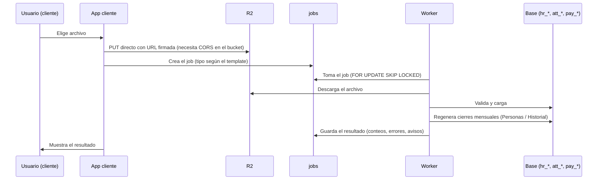

# Carga de archivos y cierres mensuales (worker)

**Fecha:** 2026-10-14
**Estado:** MVP

## Resumen

El cliente sube archivos CSV o Excel desde Integraciones. La app los guarda en un bucket R2 y crea un job; el worker (Fly.io) los descarga, valida fila por fila, carga los datos y, cuando corresponde, regenera los cierres mensuales que alimentan los dashboards. Los errores se informan en la pantalla de la integración, con fila, empleado, campo y mensaje; las filas válidas se cargan igual.

## Arquitectura

### Flujo

### Templates (`int_templates`)
| Template | Job | Contenido |
|---|---|---|
| `file_people` | `file_people` | Personas y sus unidades actuales |
| `file_org_history` | `file_org_history` | Historia de unidades por persona y tipo |
| `file_time` | `file_time_attendance` | Asistencia diaria |
| `file_absenteeism` | `file_absenteeism` | Eventos de ausentismo |
| `file_payroll` | `file_payroll` | Liquidaciones |

Los templates se registran con `db:seed:prod-catalog` y se asignan a cada tenant en el CMP (Integraciones). La pantalla de la integración muestra las columnas del archivo y descarga un ejemplo (`apps/cliente/public/examples/`).

### Archivos clave
- Subida: `apps/cliente/app/(dashboard)/integrations/_actions/upload.actions.ts`, `_components/file-upload.tsx`, `jobs-table.tsx`, `template-info.tsx`.
- Worker: `jobs/worker/src/handlers/<template>/` (`parser.ts`, `upsert.ts`, `index.ts`), `handlers/shared/` (contexto de tenant, unidades, integraciones) y `src/snapshots/peopleSnapshots.ts`.
- Ejemplos regenerables: `jobs/worker/scripts/generate-examples.ts`.

## Archivo de Personas

**Obligatorias:** `employee_code`, `full_name`, `hire_date`, `status` (`active`, `inactive` u `on_leave`; se aceptan `activo`, `inactivo`, `terminated`, `baja`, `licencia`) y `<tipo>_code` de **cada tipo que sea dimensión del tenant** (`company_code`, `location_code`, `area_code`, `position_code`, `contract_code` por defecto).

**Opcionales:** `termination_date`, `termination_reason_code`, `email`, `birth_date`, `gender`, `document_type`, `document_number`, `manager_code`, `<tipo>_name` y `<tipo>_code` / `_name` de cualquier otro tipo habilitado. La columna `contract_type` de archivos anteriores se acepta como alias de `contract_code`.

**Validaciones por fila** (la fila inválida no se carga; el resto sí):
- una persona `inactive` debe traer `termination_date` y `termination_reason_code`;
- el motivo debe existir en `cfg_termination_reasons`;
- una persona no inactiva no puede tener una baja ya cumplida (una fecha futura se admite);
- la baja no puede ser anterior al ingreso;
- las fechas deben ser reales (formato `YYYY-MM-DD` o `DD/MM/YYYY`);
- `employee_code` no repetido en el archivo;
- largos máximos por campo;
- cada dimensión obligatoria debe traer su código.

Si faltan **columnas** obligatorias, el job entero falla con la lista de las faltantes.

**Efecto en la base:** las personas y las unidades se crean o actualizan; los jefes se resuelven por `manager_code` al final; las unidades se manejan como se describe en `unidades-organizativas.md`.

## Archivo de Historial de unidades

Columnas: `employee_code`, `org_unit_type` (código del tipo), `org_unit_code`, `org_unit_name` (opcional), `valid_from`, `valid_to` (opcional; vacío = vigente).

- La persona debe existir: se carga **después** del archivo de Personas.
- El tipo debe estar habilitado para el tenant.
- Para cada (persona, tipo) los períodos no pueden solaparse y solo el último puede estar abierto; si no, se rechaza ese historial completo.
- Reemplaza el historial existente de esa persona y tipo.

## Cierres mensuales (`hr_people_history`)

- **Qué es:** el estado de cada persona al cierre de cada mes: quién estaba activo y con qué unidades vigentes. Cada fila se marca `source: "reconstructed"`.
- **Ventana:** los últimos 24 meses cerrados.
- **Cuándo se generan:**
  1. al terminar un job de Personas o de Historial se reconstruye la ventana completa del tenant;
  2. el worker, cada hora (`SNAPSHOTS_INTERVAL_SECONDS`), genera los meses cerrados que falten de cada tenant activo. Es lo que hace que un mes nuevo aparezca solo.
- **Concurrencia:** hay un candado por tenant; si dos procesos coinciden, uno espera y el otro se saltea.
- **Si falla** la reconstrucción tras una carga, el job se completa igual y muestra un aviso; el reintento horario lo recupera.
- La misma lógica SQL existe en `packages/db/src/snapshots/people-snapshots.ts` (la usa el seed de desarrollo). Si se cambia una, hay que cambiar la otra.

## Decisiones técnicas relevantes

- **Subida directa a R2 con URL firmada:** los archivos no pasan por el servidor de la app; requiere configurar CORS en el bucket de cada entorno.
- **Validar por fila y cargar lo válido:** un error no debe tirar abajo un archivo de miles de filas; el resultado informa qué quedó afuera.
- **Savepoint por fila** en la carga de personas y de historial: un error de base de una fila no revierte el lote.
- **Contexto de tenant en toda consulta del worker:** aunque en producción el rol saltea RLS, el worker setea `app.current_tenant_id` en cada acceso a tablas de tenant para que el mismo código funcione con un rol sin ese privilegio (local y futuros entornos).
- **Cierres reconstruidos, no congelados:** como el historial exacto está en las asignaciones con vigencia, los cierres se pueden recalcular; la marca `source` permite congelar cierres reales más adelante sin migración.

## Cómo extender

- **Nuevo template de archivo:** seguir el skill `ADD_INTEGRATION` y registrar el handler en `jobs/worker/src/handlers/index.ts`, el mapa de `JOB_TYPE_MAP` en `upload.actions.ts`, las columnas en `template-info.tsx`, el template en `seed/index.ts` y `seed/prod-catalog.ts`, y el nombre del destino en los `TARGET_LABELS` del CMP.
- **Nueva dimensión obligatoria:** es configuración (ver `unidades-organizativas.md`); el parser lee las columnas del tenant sin cambios de código.

## Variables del worker
`DATABASE_URL`, `R2_ENDPOINT`, `R2_ACCESS_KEY_ID`, `R2_SECRET_ACCESS_KEY`, `R2_BUCKET`, `WORKER_ID`, `SCHEDULER_ENABLED`, `PROCESSOR_ENABLED`, `SNAPSHOTS_ENABLED`, `SNAPSHOTS_INTERVAL_SECONDS`. Detalle en `jobs/worker/.env.example`.

## Pendientes
- [ ] Mostrar en el CMP los cierres mensuales por tenant y permitir regenerarlos a mano.
- [ ] Reintentos y notificación al usuario cuando un job falla.
- [ ] Soporte de archivos grandes (hoy 20 MB).
- [ ] Verificar las demás cargas (Asistencia, Ausentismo, Liquidaciones) con archivos de volumen real.

## Changelog
| Fecha | Cambio |
|---|---|
| 2026-10-14 | Versión inicial |
