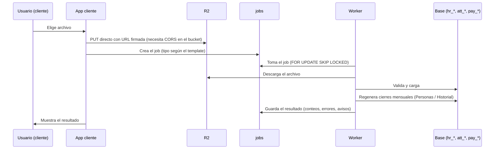

# Carga de archivos y cierres mensuales (worker)

**Fecha:** 2026-10-14
**Estado:** MVP

## Resumen

El cliente sube archivos CSV o Excel desde Integraciones. La app los guarda en un bucket R2 y crea un job; el worker (Fly.io) los descarga, valida fila por fila, carga los datos y, cuando corresponde, regenera los cierres mensuales que alimentan los dashboards. Los errores se informan en la pantalla de la integración, con fila, empleado, campo y mensaje; las filas válidas se cargan igual.

## Arquitectura

### Flujo

### Templates (`int_templates`)
| Template | Job | Contenido |
|---|---|---|
| `file_people` | `file_people` | Personas y sus unidades actuales |
| `file_org_history` | `file_org_history` | Historia de unidades por persona y tipo |
| `file_time` | `file_time_attendance` | Horas por tipo de hora, por persona y día |
| `file_absenteeism` | `file_absenteeism` | Eventos de ausentismo |
| `file_payroll` | `file_payroll` | Liquidaciones por persona, proceso y concepto |

Los templates se registran con `db:seed:prod-catalog` y se asignan a cada tenant en el CMP (Integraciones). La pantalla de la integración muestra las columnas del archivo y descarga un ejemplo (`apps/cliente/public/examples/`).

### Archivos clave
- Subida: `apps/cliente/app/(dashboard)/integrations/_actions/upload.actions.ts`, `_components/file-upload.tsx`, `jobs-table.tsx`, `template-info.tsx`.
- Worker: `jobs/worker/src/handlers/<template>/` (`parser.ts`, `upsert.ts`, `index.ts`), `handlers/shared/` (contexto de tenant, unidades, integraciones) y `src/snapshots/peopleSnapshots.ts`.
- Ejemplos regenerables: `jobs/worker/scripts/generate-examples.ts`.

## Archivo de Personas

**Obligatorias:** `employee_code`, `full_name`, `hire_date`, `status` (`active`, `inactive` u `on_leave`; se aceptan `activo`, `inactivo`, `terminated`, `baja`, `licencia`) y `<tipo>_code` de **cada tipo que sea dimensión del tenant** (`company_code`, `location_code`, `area_code`, `position_code`, `contract_code` por defecto).

**Opcionales:** `termination_date`, `termination_reason_code`, `email`, `birth_date`, `gender`, `document_type`, `document_number`, `manager_code`, `<tipo>_name` y `<tipo>_code` / `_name` de cualquier otro tipo habilitado. La columna `contract_type` de archivos anteriores se acepta como alias de `contract_code`.

**Validaciones por fila** (la fila inválida no se carga; el resto sí):
- una persona `inactive` debe traer `termination_date` y `termination_reason_code`;
- el motivo debe existir en `cfg_termination_reasons`;
- una persona no inactiva no puede tener una baja ya cumplida (una fecha futura se admite);
- la baja no puede ser anterior al ingreso;
- las fechas deben ser reales (formato `YYYY-MM-DD` o `DD/MM/YYYY`);
- `employee_code` no repetido en el archivo;
- largos máximos por campo;
- cada dimensión obligatoria debe traer su código.

Si faltan **columnas** obligatorias, el job entero falla con la lista de las faltantes.

**Efecto en la base:** las personas y las unidades se crean o actualizan; los jefes se resuelven por `manager_code` al final; las unidades se manejan como se describe en `unidades-organizativas.md`.

## Archivo de Historial de unidades

Columnas: `employee_code`, `org_unit_type` (código del tipo), `org_unit_code`, `org_unit_name` (opcional), `valid_from`, `valid_to` (opcional; vacío = vigente).

- La persona debe existir: se carga **después** del archivo de Personas.
- El tipo debe estar habilitado para el tenant.
- Para cada (persona, tipo) los períodos no pueden solaparse y solo el último puede estar abierto; si no, se rechaza ese historial completo.
- Reemplaza el historial existente de esa persona y tipo.

## Archivo de Ausentismo

Columnas: `employee_code`, `absenteeism_type_code`, `start_date`, `end_date` (obligatorias); `days_count`, `hours_count`, `justified`, `status`, `notes`, `absenteeism_type_name`, `absenteeism_class`, `counts_as_absence` (opcionales).

- La persona debe existir: se carga **después** del archivo de Personas. Las filas de personas inexistentes se omiten (el resto se procesa) y el resultado trae un aviso con la cantidad y los códigos.
- Validaciones por fila: fin no anterior al inicio, estado (`open | closed | cancelled`), clase válida, horas por día entre 0 y 24, días no negativos, `counts_as_absence` booleano. Las filas con error se informan con su número de fila de Excel.
- Una ausencia se identifica por (persona, tipo, fecha de inicio): volver a cargar actualiza, no duplica.

**Importes: qué significan.** `days_count` y `hours_count` son opcionales y se guardan solo si vienen (vacío o 0 = no informado):
- `days_count`: días del evento.
- `hours_count`: horas de ausencia **por día**, solo en una ausencia parcial (4 = medio día). Vacío = día completo. Un evento del 01/10 al 03/10 con `days_count = 3` y `hours_count = 4` son 3 × 4 = 12 horas, o 1,5 días con un turno de 8 horas.
- El cálculo de días y horas efectivos **no se hace al cargar** sino al consultar (dashboard de Ausentismos), con el turno vigente de la persona, para que un cambio de horario en Configuración > Turnos sea coherente. Reglas: sin importes, los días laborables del rango según el turno; solo días, horas = días × horas diarias; con horas por día, horas = días × horas por día (tope: las horas diarias del turno) y días efectivos = horas ÷ horas diarias.

**Tipos de ausencia.** Si el código no existe se crea; uno existente **no se modifica** (manda lo que edite el admin en Configuración > Tipos de ausencia). Un tipo nuevo se clasifica con, en orden: la clase del archivo (`absenteeism_class`), el catálogo global de tipos por defecto (mismo código) o nada (queda *sin clasificar*, cuenta como ausentismo y el resultado avisa).

**Turnos.** El horario de cada turno no viaja en el archivo: la unidad de tipo Turno llega con el archivo de Personas (`shift_code` y `shift_name`, opcionales) y los horarios se cargan en Configuración > Turnos. Sin horario propio se usa el de la empresa (CMP, tarjeta Asistencia).

## Archivo de Asistencia (horas por tipo)

Columnas, todas obligatorias: `employee_code`, `date`, `time_entry_type`, `hours`. **Una fila por persona, día y tipo de hora** (por ejemplo `EMP001, 2026-10-18, OT50, 2`). Los tipos y sus cantidades los calcula el sistema de origen (el de tiempo y asistencia del cliente); wlA no los deriva. Las horas programadas no viajan en el archivo: salen del turno de cada persona o del horario por defecto de la empresa.

- La persona debe existir: se carga **después** del archivo de Personas. Las filas de personas inexistentes se omiten (el resto se procesa); el resultado trae un aviso con la cantidad y los códigos.
- Validaciones por fila: fecha real, horas entre 0 y 24 (coma o punto decimal), tipo y persona no vacíos. Las filas con error se informan con su número de fila de Excel. Si faltan **columnas** obligatorias, el job entero falla con la lista (un archivo con el formato anterior, `worked_hours` y compañía, falla así).
- Una hora se identifica por (persona, día, tipo): volver a cargar **reemplaza las horas de ese día y tipo** y no toca los demás tipos del día. Si el archivo repite la misma persona, día y tipo gana la última fila y se avisa.
- **Tipos de hora.** Si el código no existe en el tenant se crea; uno existente **no se modifica** (manda lo que edite el admin en Configuración > Tipos de hora). Un tipo nuevo toma la categoría del catálogo base si el código coincide (`REGULAR`, `OT50`, `OT100`, `OT50NA`, etc.); si no, queda *sin clasificar* (categoría `other`: no cuenta como hora extra) y el resultado avisa.
- **Categorías.** `regular`, `overtime` (hora extra: forma la tasa del dashboard), `overtime_na` (hora extra no autorizada: se muestra aparte), `training`, `holiday`, `absence` y `other`. Las nocturnas regulares (`NIGHT`) y las extras nocturnas (`OTNIGHT`) son tipos distintos.
- **Cabecera diaria.** Por cada persona y día se mantiene una fila en `att_time_daily` con `worked_hours` (suma de los tipos que suman, es decir signo +1) y `has_absence` (hay un tipo de categoría ausencia con horas). Se recalculan en cada carga. Un día que suma más de 24 horas se carga igual y el resultado avisa.
- **Volumen y rendimiento.** La carga es por lotes de 5.000 filas, cada uno en su transacción (5.400 filas en menos de 1 s). Los totales del día se calculan y se aplican por clave primaria a propósito: con una actualización con subconsulta, el planificador de Postgres con estadísticas viejas (tablas recién llenadas) tardaba 15 s en lugar de 0,1 s.
 Al terminar, el worker ejecuta `ANALYZE` de `att_time_daily` y `att_time_daily_entries` para que los dashboards no dependan de estadísticas viejas tras una carga grande.

## Archivo de Liquidaciones

**Una fila por persona, proceso y concepto.** Obligatorias: `employee_code`, `period_code`, `process_code`, `process_start`, `process_end`, `concept_code`, `concept_name`, `amount`. Opcionales: `process_description`, `process_type`, `quantity`. wlA **no calcula nada de la liquidación**: toma los importes exactamente con el signo con el que vienen del sistema de origen (las retenciones, negativas) y los acumuladores (total bruto, total neto) llegan como conceptos más.

- **Jerarquía.** Período (el mes de liquidación, `AAAA-MM`) → proceso (mensual, quincenal, semanal, SAC, ajustes, provisiones, liquidación final, vacaciones) → persona → concepto. Un período tiene uno o varios procesos; el período y el proceso se crean con el archivo si no existen. `process_type` acepta el código en inglés o el nombre en español (default `monthly`). Si un proceso aparece con fechas o tipo distintos entre filas se toman los de la primera fila y se avisa.
- **Persona.** Debe existir: se carga después del archivo de Personas. Las filas de personas inexistentes se omiten (aviso con cantidad y códigos).
- **Conceptos.** Si el código no existe se crea **sin clasificar** (`is_classified = false`, sin tipo) y el resultado avisa; uno existente **no se modifica** (manda lo que edite el admin en Configuración > Conceptos de liquidación). El tipo (13 tipos estándar), la clase y cuál acumulador es el sueldo bruto y cuál el neto se definen ahí, no en el archivo.
- **Repetidas.** Varias filas de la misma persona, proceso y concepto **se suman** (importe y cantidad) y se avisa. Volver a cargar el mismo archivo deja los mismos totales (reemplaza el valor de cada persona, proceso y concepto, no suma de nuevo ni borra nada).
- **Validaciones por fila:** período `AAAA-MM`, fechas reales con `process_end` no anterior a `process_start`, tipo de proceso válido, importe numérico (hasta 12 dígitos enteros, coma o punto decimal) y cantidad numérica menor a 10.000. Las filas con error se informan con su número de fila de Excel; si faltan **columnas** obligatorias el job entero falla con la lista (un archivo con el formato anterior, `concept_category` y `period_start`, falla así).
- **Avisos:** personas inexistentes, conceptos nuevos sin clasificar, filas sumadas, procesos con fechas distintas y, mientras no haya un acumulador marcado como bruto y otro como neto, un recordatorio para definirlos.
- **Volumen.** Carga por lotes de 5.000 filas, cada uno en su transacción (4.400 filas de ejemplo en menos de 0,5 s); al terminar se ejecuta `ANALYZE pay_entries`.
- **Ejemplo:** 12 meses (oct-2025 a sep-2026) de las 48 personas: 4.416 filas, 17 procesos (12 mensuales, SAC de junio y diciembre, 3 de ajustes) y 16 conceptos. Al cargarlo por primera vez todos los conceptos quedan sin clasificar: clasificarlos en el portal es parte de la prueba.

## Cierres mensuales (`hr_people_history`)

- **Qué es:** el estado de cada persona al cierre de cada mes: quién estaba activo y con qué unidades vigentes. Cada fila se marca `source: "reconstructed"`.
- **Ventana:** los últimos 24 meses cerrados.
- **Cuándo se generan:**
  1. al terminar un job de Personas o de Historial se reconstruye la ventana completa del tenant;
  2. el worker, cada hora (`SNAPSHOTS_INTERVAL_SECONDS`), genera los meses cerrados que falten de cada tenant activo. Es lo que hace que un mes nuevo aparezca solo.
- **Concurrencia:** hay un candado por tenant; si dos procesos coinciden, uno espera y el otro se saltea.
- **Si falla** la reconstrucción tras una carga, el job se completa igual y muestra un aviso; el reintento horario lo recupera.
- La misma lógica SQL existe en `packages/db/src/snapshots/people-snapshots.ts` (la usa el seed de desarrollo). Si se cambia una, hay que cambiar la otra.

## Decisiones técnicas relevantes

- **Subida directa a R2 con URL firmada:** los archivos no pasan por el servidor de la app; requiere configurar CORS en el bucket de cada entorno.
- **Validar por fila y cargar lo válido:** un error no debe tirar abajo un archivo de miles de filas; el resultado informa qué quedó afuera.
- **Savepoint por fila** en la carga de personas y de historial: un error de base de una fila no revierte el lote.
- **Contexto de tenant en toda consulta del worker:** aunque en producción el rol saltea RLS, el worker setea `app.current_tenant_id` en cada acceso a tablas de tenant para que el mismo código funcione con un rol sin ese privilegio (local y futuros entornos).
- **Cierres reconstruidos, no congelados:** como el historial exacto está en las asignaciones con vigencia, los cierres se pueden recalcular; la marca `source` permite congelar cierres reales más adelante sin migración.

## Cómo extender

- **Nuevo template de archivo:** seguir el skill `ADD_INTEGRATION` y registrar el handler en `jobs/worker/src/handlers/index.ts`, el mapa de `JOB_TYPE_MAP` en `upload.actions.ts`, las columnas en `template-info.tsx`, el template en `seed/index.ts` y `seed/prod-catalog.ts`, y el nombre del destino en los `TARGET_LABELS` del CMP.
- **Nueva dimensión obligatoria:** es configuración (ver `unidades-organizativas.md`); el parser lee las columnas del tenant sin cambios de código.

## Variables del worker
`DATABASE_URL`, `R2_ENDPOINT`, `R2_ACCESS_KEY_ID`, `R2_SECRET_ACCESS_KEY`, `R2_BUCKET`, `WORKER_ID`, `SCHEDULER_ENABLED`, `PROCESSOR_ENABLED`, `SNAPSHOTS_ENABLED`, `SNAPSHOTS_INTERVAL_SECONDS`. Detalle en `jobs/worker/.env.example`.

## Pendientes
- [ ] Mostrar en el CMP los cierres mensuales por tenant y permitir regenerarlos a mano.
- [ ] Reintentos y notificación al usuario cuando un job falla.
- [ ] Soporte de archivos grandes (hoy 20 MB).
- [ ] Verificar la carga de Liquidaciones con archivos de volumen real (probada con 4.400 filas de ejemplo). Ausentismo: probado con 24 meses y 453 eventos de ejemplo. Asistencia: probada con 6 meses y 5.400 filas de ejemplo.

## Changelog
| Fecha | Cambio |
|---|---|
| 2026-10-14 | Versión inicial |
| 2026-10-16 | Archivo de Ausentismo: clasificación de tipos nuevos, validaciones, importes opcionales (horas por día), avisos de personas omitidas |
| 2026-10-19 | Archivo de Asistencia: nuevo formato de horas por tipo (una fila por persona, día y tipo), tipos de hora por tenant, carga por lotes |
| 2026-10-21 | Archivo de Liquidaciones: nuevo formato por proceso y concepto (período → proceso → persona → concepto), conceptos nuevos sin clasificar, repetidas sumadas, carga por lotes |
