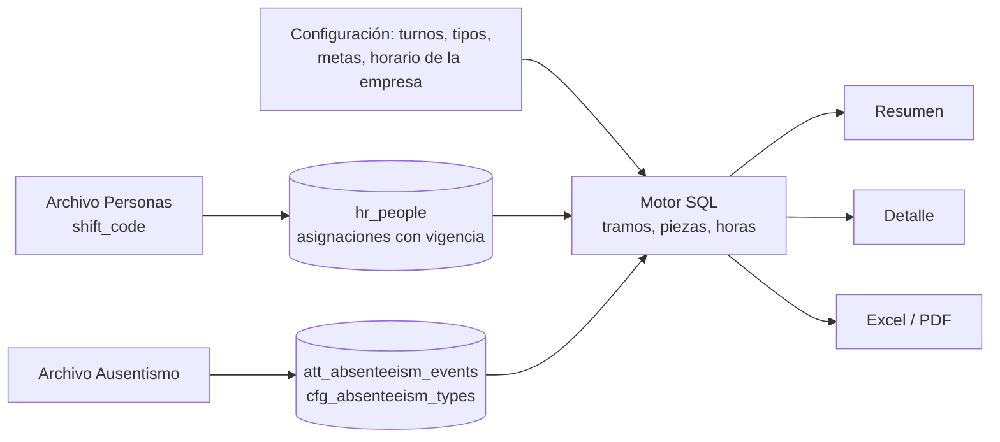

# Dashboard Ausentismos (Dashboard 2 de M3)

**Fecha:** 2026-10-16
**Estado:** MVP (resumen, detalle y exportaciones completos, más los dos reportes anexos: «Resumen por fecha y unidad» y «Cuadro por tipo y unidad»)

## Resumen

Muestra cuánto ausentismo hay y dónde se concentra: la **tasa de ausentismo** (horas de ausencia sobre horas programadas), su evolución de 12 meses contra la meta del tenant, la ausencia por clase y tipo, y la tasa por cada **dimensión configurada del tenant**. Cada número se abre hasta los eventos o las personas que lo componen, y todo se exporta a Excel o PDF. Está pensado para una pantalla de 15.6" sin scroll.

Audiencia: RRHH y People Analytics (todos los roles del tenant ven lo mismo). Datos: eventos de ausencia (`att_absenteeism_events`), personas y unidades con vigencia, y el horario de cada turno.

## Arquitectura

### Tablas involucradas
- `att_absenteeism_events`: eventos con `days_count` y `hours_count` opcionales (ver "Importes").
- `cfg_absenteeism_types`: tipos del tenant con su `class`, `counts_as_absence` e `is_classified`. El catálogo global `cfg_absenteeism_type_defaults` se copia a cada tenant nuevo.
- `hr_shift_schedules`: horas diarias y semana laboral (`1111100`, lunes a domingo) de cada unidad de tipo `SHIFT`.
- `cfg_tenant_settings`: modo de asistencia (`basic` | `detailed`), semana y horas por defecto de la empresa, formato de ausencias (horas, días o ambas).
- `cfg_tenant_metric_targets`: meta del tenant (ausentismo 4 % mensual por defecto).
- `hr_people`, `hr_people_org_assignments`, `hr_org_units`: ingreso, baja y unidades con vigencia (ver `unidades-organizativas.md`).
- `dsh_dimensions` (dashboard `absenteeism`): dimensiones del dashboard; por defecto las mismas cinco que Headcount.
- Función SQL `wla_workdays(desde, hasta, semana)`: días laborables entre dos fechas en tiempo constante.

### Archivos clave
Todo bajo `apps/cliente/app/(dashboard)/absenteeism/`:

| Ruta | Contenido |
|---|---|
| `page.tsx` | Resumen (Server Component): KPIs, gráficos, filtros, avisos y estados |
| `[scope]/[[...id]]/page.tsx` | Drill-down: `eventos`, `personas`, `clase/<código>`, `tipo/<código>`, `dim/<tipo>/<id>` |
| `export/route.ts` | Descarga Excel y PDF (`?format=xlsx|pdf` + filtros) |
| `reportes/fecha/` | Reporte «Resumen por fecha y unidad» (`page.tsx`, `export/route.ts`), con `reportes/_data/by-date.ts`, `_components/` y `_export/` |
| `reportes/tipos/` | Reporte «Cuadro por tipo y unidad» (`page.tsx`, `export/route.ts`), con `reportes/_data/by-type.ts` |
| `_data/engine.ts` | **Motor de cálculo en SQL** (ver abajo) |
| `_data/queries.ts` | `loadAbsenteeism` (una sola evaluación del motor) y `resolveRange` (mes de referencia y cobertura) |
| `_data/detail-queries.ts` | Listados del drill-down, calculados con el mismo motor |
| `_data/filters.ts`, `hrefs.ts`, `types.ts` | Parámetros de URL, enlaces y tipos |
| `_components/` | Evolución con meta, panel Clase/Tipo, barras de tasa por dimensión, filtros, frescura |
| `_export/` | `report.ts`, `xlsx.ts`, `pdf-document.tsx` |

Del kit compartido (`_dashboard-kit/`) se reutilizan el shell, las tarjetas, los filtros y el menú de exportación. Con este dashboard pasaron al kit `period.ts`, `dimensions.ts` (con el código de dashboard como parámetro) y `dimension-filters.ts`; `MetricCard` admite formatos y contenido propios.

Configuración (otras pantallas):
- CMP, detalle del tenant: tarjeta **Asistencia** (modo, semana laboral y horas por defecto, formato horas/días) y dimensiones de cada dashboard. Pantalla `/absence-types`: catálogo global de tipos por defecto.
- Portal del cliente, `/settings`: **Turnos** (horario de cada turno), **Tipos de ausencia** (clasificación) y **Metas**. Solo el rol admin edita.

### Flujo de datos



## Motor de cálculo (`_data/engine.ts`)

Se evalúa **una sola vez por pantalla** y de esa evaluación salen todos los agregados.

1. **Tramos:** cada persona se divide en intervalos donde no cambia ni el turno ni ninguna unidad usada como filtro o agrupación. Un tramo va de `max(ingreso, desde)` a `min(baja − 1, hasta)`: la persona deja de contar desde el día de la baja, igual que el headcount del Dashboard 1.
2. **Piezas:** cada tramo se parte por mes. En cada pieza, días laborables = días de la semana del turno vigente (o de la empresa si no tiene turno) y **horas programadas = días laborables × horas por día**.
3. **Ausencias:** cada evento (no cancelado) se cruza con las piezas de su persona. `counts` indica si el tipo cuenta como ausentismo y `in_scope` si pasa el filtro de clase/tipo; las que no cuentan (vacaciones, licencias de ley, francos) se informan aparte como "fuera de la tasa".
4. **Dimensiones:** filtros y agrupaciones usan la unidad vigente de cada pieza, es decir, la vigente cada día.

### Importes de un evento
- Sin `days_count` ni `hours_count`: cada día laborable del rango cuenta las horas diarias del turno.
- `days_count`: el factor es `days_count ÷ días laborables del rango` (con el turno vigente al inicio del evento); si el archivo trae los días, **mandan**.
- `hours_count`: horas de ausencia **por día** (ausencia parcial: 4 = medio día), con tope en las horas diarias del turno. Un evento del 01/10 al 03/10 con `days_count = 3` y `hours_count = 4` son 12 horas, o 1,5 días con un turno de 8 horas.
- Días efectivos de una pieza = sus horas ÷ las horas diarias de su turno.

## Reglas de cálculo

- **Tasa de ausentismo** = horas de ausencia ÷ horas programadas. En un período de varios meses se suman numeradores y denominadores (no se promedian tasas).
- **Mes de referencia:** el último **mes calendario cerrado**. Si el período empieza antes del primer evento cargado, se calcula desde ese mes y se avisa "cobertura parcial". Los meses sin cobertura figuran como "sin datos", no como 0 %.
- **Eventos:** los que cuentan, no cancelados, con horas en el período; un evento de varios meses cuenta una vez por período. **Personas afectadas:** personas distintas con ausencia que cuenta en el período; el % es sobre las personas con horas programadas. **Duración promedio:** días efectivos ÷ eventos.
- **Períodos y comparación:** `month`, `12m` y `year` contra el período equivalente anterior (igual que Headcount); la comparación se oculta si el período anterior no tiene cobertura. Referencia secundaria: tasa de los últimos 12 meses (si hay al menos 6 con datos).
- **Meta:** `cfg_tenant_metric_targets` o 4 % por defecto. Se muestra como línea de referencia y como estado en la tarjeta ("+0,8 pp sobre la meta"), con ícono y texto (no solo color).
- **Muestra chica:** una unidad con menos de 3 personas con horas programadas se marca con asterisco; no se oculta.
- **Sin asignar:** cualquier dimensión admite el token `none`, igual que en Headcount.
- **Limitaciones:** no se descuentan feriados (las horas programadas pueden estar sobreestimadas, alrededor de 4 % en un año). El modo de asistencia `detailed` (por API) todavía no tiene motor propio: se avisa y se calcula con turnos.

## Contrato de URL

| Parámetro | Significado |
|---|---|
| `p` | `month` (por defecto) \| `12m` \| `year` |
| `f_<tipo>` | Unidades de la dimensión, ids separados por coma; `none` = Sin asignar |
| `f_class` | Clases de ausencia (códigos separados por coma) |
| `f_type` | Códigos de tipo de ausencia |
| `q`, `s`, `d`, `page` | Solo en el detalle: búsqueda, orden y página (50 por página) |

## Pantalla y estados

- **Distribución:** KPIs (tasa, ausencia total, eventos, personas afectadas); fila 1 = evolución de 12 meses + panel Clase/Tipo; fila 2 = una tasa por dimensión (más de 4 dimensiones: el último panel pasa a pestañas); pie con lo que queda fuera de la tasa y "Cómo se calcula".
- **Formato de ausencias** (CMP): horas, días o ambas en las tarjetas, tooltips, listados y exportaciones.
- **Estados:** carga, vacío (sin eventos, con enlace a Integraciones), sin resultados (con "Limpiar filtros"), desactualizado (más de 45 días sin carga), cobertura parcial, comparación no disponible, tipos sin clasificar (aviso con enlace a Configuración) y asistencia detallada pendiente.
- **Accesibilidad:** resumen textual y tabla equivalente por gráfico, flechas con signo y texto, filtros y pestañas operables con teclado.

## Reporte: resumen por fecha y unidad (`/absenteeism/reportes/fecha`)

Anexo del dashboard, pensado para el seguimiento diario (basado en reportes reales de clientes).

- **Filas:** unidades de la dimensión elegida (`g=<tipo>`; `g=total` = solo total general), con fila de total general. **Columnas:** dotación asignada · presentes (estimado) · franco · vacaciones · licencia de ley · sin aviso · sin goce · enfermedad · accidente · suspensión · otras · total de ausentes · % de ausentismo.
- **Fecha:** un día (`from`) o un período (`from`–`to`, máximo 366 días). Por defecto, el último día hábil del mes de referencia. Las fechas inválidas vuelven al valor por defecto.
- **Filtros:** las dimensiones del dashboard (`f_<tipo>`, con "Sin asignar"). No lleva filtros de clase ni de tipo porque las clases son las columnas.
- **Cálculo** (mismo motor que el resumen):
  - Dotación asignada = personas con día laborable según su turno ese día (en un período, suma de personas-día).
  - Francos, vacaciones, licencias y ausencias salen de la clase de cada evento; las ausencias parciales cuentan como fracción de día.
  - Presentes (estimado) = dotación − francos − vacaciones − licencias − ausentes. Los presentes reales requieren asistencia detallada (por API).
  - % de ausentismo = ausentes ÷ dotación asignada. «Otras» agrupa las clases `personal` y `other`.
  - En un solo día, una persona con más de un evento se cuenta una vez (prioridad al que cuenta como ausentismo); en un período se suman personas-día.
- **Exportaciones:** Excel (una hoja con metadatos, filtros, filas y notas) y PDF apaisado.

## Reporte: cuadro por tipo de ausencia y unidad (`/absenteeism/reportes/tipos`)

- **Filas:** tipos de ausencia que cuentan como ausentismo (los demás son los «tipos excluidos»); por defecto solo los que tienen ausencias en el período (`all=1` muestra todos). **Columnas:** las unidades de la dimensión elegida (`g=<tipo>`, o `g=total`), más **Total**, **Incidencia** y **Índice**.
- **Filtros:** los mismos del dashboard (período, dimensiones, clase y tipo, todo en la URL).
- **Cantidad (`m`):** eventos (por defecto), días u horas efectivos. Los días y las horas son los del período y los filtros, calculados por el mismo motor.
- **Pie del cuadro:** total de ausencias, dotación (personas con horas programadas en el período), **índice del grupo** (ausencias de la unidad ÷ personas de la unidad) e **índice sobre la empresa** (ausencias de la unidad ÷ personas de toda la empresa).
- **Índices** = cantidad cada 100 personas (se muestran sin `%` y pueden superar 100 en períodos largos). **Incidencia** = peso del tipo sobre el total de ausencias; **Índice** de un tipo = su total ÷ personas de la empresa × 100.
- **Totales sin repetir eventos:** una persona que cambió de unidad en el período figura en ambas, y un evento que cruza unidades se cuenta en cada una; el total y la dotación general no repiten.
- **Exportaciones:** Excel (todas las unidades) y PDF apaisado (hasta 14 unidades; el Excel trae el resto).

## Detalle y exportaciones

- **Detalle:** páginas con breadcrumb, búsqueda por nombre o legajo, orden y paginación. Eventos: persona, legajo, una columna por dimensión (unidad vigente al inicio del evento), tipo, clase, fechas, días y horas del período, estado. Personas: eventos, días y horas. **No se ordena por cantidad de ausencia ni se muestran observaciones** (decisión de privacidad: no hay ranking de personas).
- **Excel:** hojas Resumen (metadatos, filtros, KPIs y notas), Evolución, Clase y tipo (incluye lo que queda fuera de la tasa), Por dimensión, Eventos y Personas.
- **PDF paginado** con cabecera de filtros, indicadores, distribuciones y los dos listados con cabecera repetida.
- **Tope:** 20.000 filas por listado.

## Decisiones técnicas relevantes

- **Cálculo al consultar, no al cargar:** el archivo guarda los importes que trae (o `NULL`); las horas efectivas se calculan con el turno vigente. Así un cambio de horario en Configuración > Turnos es siempre coherente.
- **Tramos en lugar de persona por día:** con miles de personas, expandir por día son millones de filas por consulta; los tramos reducen el cálculo a unas decenas de miles de piezas.
- **Una evaluación del motor por pantalla:** KPIs, evolución, clase, tipo, dimensiones y "fuera de la tasa" salen del mismo CTE materializado.
- **Función de días laborables aritmética** (`wla_workdays`): sin recorrer los días.
- **Unidad y turno vigentes cada día** (numerador y denominador): coherente con Headcount y exacto cuando alguien cambia de turno o de área.

## Cómo extender

- **Nueva dimensión:** configuración en el CMP (`dsh_dimensions`, dashboard `absenteeism`); sin código.
- **Nuevo KPI:** agregarlo al SELECT de `loadAbsenteeism`, a `types.ts`, a la tarjeta en `page.tsx` y a `kpiRows` en `_export/report.ts`.
- **Verificación de regresión:** `apps/cliente/scripts/verify-absenteeism-engine.ts` crea un tenant temporal con casos de borde, compara resumen y detalle contra una implementación independiente día por día y lo borra. Correrlo tras cualquier cambio del motor:
  ```bash
  cd apps/cliente && ../../jobs/worker/node_modules/.bin/tsx --env-file=.env.local scripts/verify-absenteeism-engine.ts
  ```

## Ajustes y aprendizajes

- **Rendimiento (medido con 3.000 personas, 20.000 eventos y 5 dimensiones):** de más de 2 minutos a 1,8–4,4 s al (1) reemplazar una función que recorría día por día por aritmética, (2) evaluar el motor una vez por pantalla en lugar de una por consulta y (3) unir eventos con piezas por persona en lugar de un `LATERAL` sobre un CTE sin índices.
- **Estadísticas de Postgres:** con tablas recién cargadas y sin `ANALYZE`, el planner eligió un nested loop de 26 millones de comparaciones (3,5 s en lugar de 0,14 s). En producción lo evita el autovacuum; en pruebas de volumen hay que correr `ANALYZE`.
- **Una prueba con argumentos constantes engaña:** el planner evalúa una sola vez las funciones inmutables con constantes; medir con argumentos variables.
- **`withTenantContext` corta a los 5 s:** admite `{ timeout }` como tercer parámetro.
- **`FULL JOIN` solo admite condiciones hash/merge:** `IS NOT DISTINCT FROM` falla; usar `COALESCE(a, -1) = COALESCE(b, -1)`.
- **Un `page.tsx` de Next solo puede exportar `default`, `metadata`, etc.:** las constantes van como locales o a otro archivo.
- **El worker local genera cierres de personas para cualquier tenant con personas:** los scripts de prueba que crean tenants temporales deben borrar `hr_people_history` antes que las personas.
- **Scripts de prueba:** el runner `tsx` suelto no carga `@react-pdf/renderer`; el PDF se verifica por HTTP contra el servidor de desarrollo.

## Pendientes
- [x] **E4:** reporte por fecha y unidad y cuadro por tipo y unidad (anexos del dashboard).
- [ ] Modo de asistencia `detailed` (asistencia diaria teórica y efectiva por integración): presentes, y denominadores propios.
- [ ] Feriados por tenant (hoy se asume que todos los días de la semana laboral son laborables).
- [ ] Si algún tenant supera unas 5.000 personas: cierre mensual de ausentismo en el worker (como el de personas) en lugar de calcular al consultar.
- [ ] Accesibilidad verificada con lector de pantalla y teclado en el navegador real; comportamiento en tablet y móvil.

## Changelog
| Fecha | Cambio |
|---|---|
| 2026-10-16 | Versión inicial: motor, resumen, detalle y exportaciones |
| 2026-10-17 | E4.1: reporte «Resumen por fecha y unidad» |
| 2026-10-18 | E4.2: «Cuadro por tipo y unidad» con índices por grupo y por empresa |
