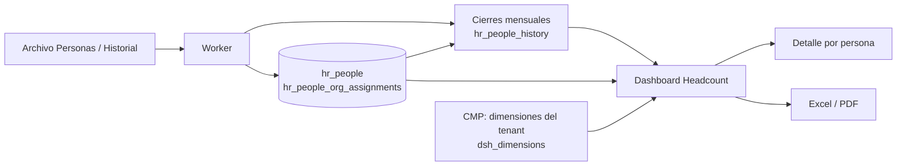

# Dashboard Headcount / Cubo (Dashboard 1 de M3)

**Fecha:** 2026-10-14
**Estado:** MVP (completo en funcionalidad; ver Pendientes)

## Resumen

Muestra la dotación de la empresa al cierre de cada mes y cómo se mueve: headcount, altas, bajas y variación neta, comparados con el período anterior y con el promedio de los últimos 12 meses, más la distribución por las **dimensiones que configura cada tenant** (hoy Empresa, Sucursal, Área, Puesto y Contrato por defecto). Está pensado para que un responsable de RRHH lo lea en una sola pantalla de 15.6" y pueda bajar a la lista de personas detrás de cada número y exportarla a Excel o PDF.

Audiencia: todos los roles del tenant ven lo mismo (aún no hay permisos por dashboard). Datos: cierres mensuales (`hr_people_history`) más fechas de ingreso y baja de `hr_people`.

## Arquitectura

### Tablas involucradas
- `hr_people`: fechas de ingreso y baja, motivo de baja, género y nacimiento (demografía del detalle).
- `hr_people_history`: cierre mensual por persona; el headcount sale de acá. Es un **caché derivado** (ver `carga-de-archivos.md`).
- `hr_people_org_assignments`: unidades de cada persona con vigencia (`valid_from` / `valid_to`). Filtra altas y bajas y llena las columnas del detalle.
- `hr_org_units`, `cfg_org_unit_types`: unidades y tipos (ver `unidades-organizativas.md`).
- `dsh_dimensions` (con `cfg_tenant_org_unit_types`): qué tipos son dimensiones de este dashboard y en qué orden.
- `cfg_termination_reasons`: motivo de baja en el detalle de bajas.

### Archivos clave
Todo bajo `apps/cliente/app/(dashboard)/`:

| Ruta | Contenido |
|---|---|
| `headcount/page.tsx` | Resumen (Server Component): KPIs, gráficos, filtros, estados |
| `headcount/[scope]/[[...id]]/page.tsx` | Drill-down: `activos`, `altas`, `bajas`, `dim/<tipo>/<id>` |
| `headcount/export/route.ts` | Descarga Excel y PDF (`?format=xlsx|pdf` + filtros) |
| `headcount/_data/` | Capa de datos: `dimensions`, `filters`, `hrefs`, `period`, `queries`, `detail-queries`, `types` |
| `headcount/_components/` | Gráficos y barra de filtros (client components) |
| `headcount/_export/` | `report.ts` (reúne los datos), `xlsx.ts`, `pdf-document.tsx` |
| `_dashboard-kit/` | Piezas reutilizables entre dashboards (ver abajo) |

Kit compartido (`_dashboard-kit/`): `dashboard-shell` (estado de carga localizado y parámetros de URL), `metric-card`, `chart-card` (más `ChartDataTable` para lectores de pantalla), `multi-select-filter`, `period-selector`, `freshness-badge`, `dashboard-states` (vacío y sin resultados), `breadcrumb`, `export-menu`, `format`.

### Flujo de datos

## Reglas de cálculo

- **Mes de referencia:** el último mes con cierre. "Mes actual" en pantalla significa ese último mes **cerrado**, no el mes en curso.
- **Headcount al cierre:** personas del cierre del mes de referencia (ya filtradas por las dimensiones).
- **Altas / bajas:** personas cuya fecha de ingreso / de baja cae en el período. Con filtros por dimensión se evalúa la unidad **vigente en esa fecha**, no la actual.
- **Variación neta:** altas menos bajas del período (puede diferir de la variación de headcount si hay datos cargados con huecos).
- **Períodos:** `month` = el mes de referencia contra el mes anterior; `12m` = 12 meses terminados en el de referencia contra los 12 previos; `year` = de enero al mes de referencia contra el mismo tramo del año anterior.
- **Referencia secundaria:** "Prom. 12m" (promedio de los últimos 12 cierres, solo si hay al menos 6) para el headcount; "Prom. 12m" mensual para altas y bajas en `month`, y "Por mes" en `12m` y `year`.
- **Sin asignar:** persona sin ninguna unidad del tipo en el cierre (o vigente en la fecha del evento). Se puede filtrar con `f_<tipo>=none`.
- **Frescura:** se informa el mes de cierre y el historial disponible; se avisa si el último cierre tiene más de 45 días o si faltan meses intermedios; sin historial suficiente se oculta la comparación.

## Contrato de URL

| Parámetro | Significado |
|---|---|
| `p` | `month` (por defecto) \| `12m` \| `year` |
| `f_<tipo>` | Unidades elegidas de la dimensión, ids separados por coma; `none` = Sin asignar. Ej.: `f_area=3,5`, `f_location=none,408` |
| `q`, `s`, `d`, `page` | Solo en el detalle: búsqueda, orden y página (50 por página) |

El estado completo vive en la URL: se puede compartir, funciona el botón atrás y cada dashboard tiene su propio estado. Los parámetros viejos `area`, `loc`, `pos` y `ct` ya no existen.

## Pantalla y estados

- **Distribución del resumen:** fila 1 = evolución de 12 meses + primera dimensión; fila 2 = el resto de las dimensiones repartidas en partes iguales. Con más de 4 paneles en la fila 2, el último pasa a ser un panel con pestañas.
- **Tipo de gráfico:** dona hasta 4 unidades (parte-todo legible), barras si hay más; "Sin asignar" no cuenta para decidirlo.
- **Una pantalla:** diseñado para 1536×730 sin scroll; en pantallas chicas apila en una columna.
- **Estados:** carga (esqueleto + atenuado localizado al cambiar filtros), vacío (sin datos todavía, con enlace a Integraciones), sin resultados (filtros que no devuelven a nadie, con "Limpiar filtros"), datos desactualizados, historial con huecos, comparación no disponible.
- **Accesibilidad:** cada gráfico trae un resumen textual y una tabla equivalente solo para lectores de pantalla; el significado no depende solo del color (flecha + signo + texto); filtros, pestañas y menús operables con teclado.

## Detalle y exportaciones

- **Detalle:** lista paginada con breadcrumb, búsqueda por nombre o legajo, orden por columna y resumen demográfico (género y franjas de edad). Una columna por dimensión, con la unidad vigente a la fecha de referencia del listado (cierre, ingreso o baja).
- **Excel:** hojas Resumen (metadatos, filtros y KPIs), Evolución, Distribuciones, Headcount al cierre, Altas y Bajas. Respeta período y filtros.
- **PDF paginado:** portada con indicadores y filtros, distribuciones y los tres listados con cabecera repetida y número de página.
- **Tope:** 20.000 filas por listado.

## Decisiones técnicas relevantes

- **Cierres mensuales en lugar de consultar estado actual** (D4 del descubrimiento): da series de tiempo consistentes y es barato de consultar. Costo: dependen del worker (`carga-de-archivos.md`).
- **Dimensiones configurables por tenant (D-109, D-111):** el código no conoce "Área" ni "Sede"; solo recorre `dsh_dimensions`. Agregar una dimensión es configuración, no código.
- **Contrato como unidad organizativa (D-108):** el contrato tiene vigencia e historia como cualquier otra dimensión. Se eliminó `hr_people.contract_type`.
- **Unidad vigente en la fecha del evento (no la actual):** una persona que cambió de área no puede contarse en dos áreas. Es la razón de que `eventFilter` consulte las asignaciones con vigencia.
- **Estado en la URL, datos en el servidor:** páginas Server Component; solo filtros, gráficos y menús son client.
- **SQL agregado en el servidor:** nunca se traen filas a memoria para sumar; todas las consultas pasan por `withTenantContext`.
- **Exportación por rutas HTTP (no captura de pantalla):** permite PDF paginado y estructurado y se genera con el mismo código de datos que la pantalla.

## Cómo extender

- **Nueva dimensión para un tenant:** en el CMP, detalle del tenant, "Unidades organizativas y dimensiones". Sin deploy.
- **Nuevo KPI:** agregarlo a `loadHeadcount` (`_data/queries.ts`), al tipo en `_data/types.ts`, a las tarjetas de `page.tsx` y a `kpiRows` en `_export/report.ts`.
- **Nuevo dashboard:** seguir el skill `ADD_DASHBOARD` (`.claude/skills/add-dashboard.md`); reutiliza `_dashboard-kit/` y el mismo patrón de `_data/`, URL, estados y exportaciones.

## Ajustes y aprendizajes

### Qué cambió respecto del diseño aprobado, y por qué
| Diseño inicial | Quedó así | Motivo |
|---|---|---|
| Drill-down como tabla en el mismo dashboard | Páginas con breadcrumb y paginación | Mucha información; pedido del cliente |
| PDF como captura del dashboard | PDF estructurado y paginado | Necesidad de tablas con datos |
| Cuatro filtros fijos (área, sede, cargo, contrato) | Dimensiones configurables por tenant (hoy 5) | Los tipos de unidad del cliente varían |
| Contrato como atributo de la persona | Contrato como unidad organizativa con vigencia | Tiene historia; evita dos mecanismos |
| Altas y bajas por la unidad "actual" | Por la unidad vigente en la fecha del evento | Evita contar a alguien en dos unidades |
| Filtro solo por unidades existentes | Más "Sin asignar" | Se veía en los gráficos pero no se podía filtrar |
| Comparación contra benchmarks por tenant | Postergado | No hay campo de metas; entra desde el Dashboard 2 |

### Reglas de diseño que quedaron firmes
1. Todo lo jerárquico entra en una pantalla de 15.6"; el detalle va aparte.
2. Los números llevan siempre su contexto: período, comparación y fecha de cierre.
3. El estado del filtro vive en la URL y cada dashboard tiene el suyo.
4. Nada depende solo del color; cada gráfico tiene su equivalente textual.
5. Cada KPI se puede abrir hasta las personas que lo componen.
6. Los estados (vacío, sin resultados, desactualizado, parcial) son parte del diseño, no un añadido.

### Lecciones de proceso
- **Primero los datos, después el diseño.** El dashboard no pudo mostrar datos reales hasta construir el modelo de unidades con vigencia, los archivos con sus dimensiones y los cierres mensuales. Para los siguientes dashboards hay que verificar **antes de diseñar** que existan las fuentes y la ingesta (puerta de datos del skill).
- **Probar de punta a punta antes de producción** (archivo → R2 → worker → base → pantalla). Las pruebas por partes dejaron pasar fallos reales: consultas sin contexto de tenant, CORS del bucket de desarrollo y cierres desfasados cuando cambiaba una fecha de baja.
- **Verificar números contra SQL independiente**, con datos de prueba armados a propósito (por ejemplo, quitar una unidad a 8 personas para probar "Sin asignar").

### Trampas técnicas
- Tablas con RLS consultadas sin `withTenantContext` fallan en local con `invalid input syntax for type uuid: ""` y no en producción (el rol de Supabase saltea RLS): un error que solo aparece en local es una señal de contexto faltante.
- Recharts necesita un contenedor con alto definido: el cuerpo del gráfico va en un `div` relativo con el gráfico absoluto adentro.
- Una `<table>` con clase `sr-only` no se recorta; hay que envolverla en un `div sr-only`.
- Prisma Client no se puede regenerar en Windows con servidores de desarrollo abiertos (el motor queda bloqueado).
- En el panel de navegador integrado la animación se pausa si no está visible: el contenido puede tardar en pintar (no es un bug de la app).
- Los números de fila de los errores de carga se cuentan como los ve el usuario en la planilla (fila 1 = encabezado).

## Pendientes
- [ ] Benchmarks configurables por tenant (ausentismo 4% mensual, horas extra 10%, rotación 18% anual): entran con el Dashboard 2.
- [ ] Verificar accesibilidad con lector de pantalla y teclado en el navegador real (hoy solo está verificada la estructura).
- [ ] Verificar el comportamiento en tablet y móvil.
- [ ] Medir rendimiento con un tenant grande (miles de personas × 24 cierres) y decidir si hace falta caché.
- [ ] Revisar el tope de 20.000 filas del PDF (el PDF puede ser muy pesado).
- [ ] Hub de dashboards y gestión por tenant (ver `BACKLOG.md`, etapa posterior a los dashboards).

## Changelog
| Fecha | Cambio |
|---|---|
| 2026-10-14 | Versión inicial: resumen, drill-down con breadcrumb, exportación Excel/PDF, dimensiones configurables, filtro "Sin asignar" |
