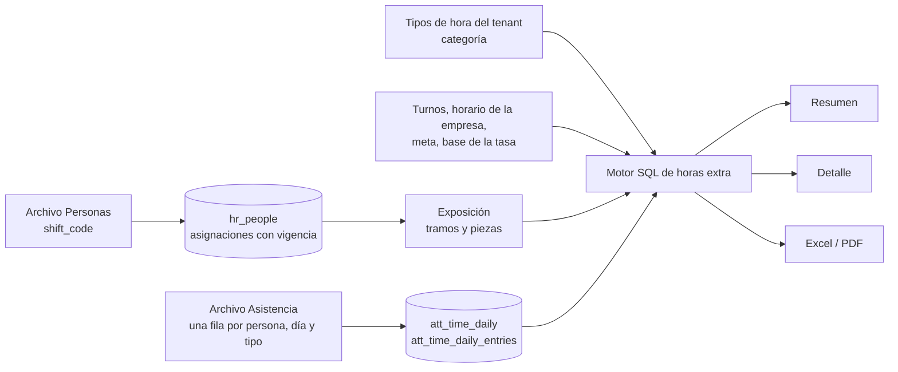

# Dashboard Horas extras (Dashboard 3 de M3)

**Fecha:** 2026-10-20
**Estado:** MVP (modelo y administración, carga de archivo, resumen, detalle y exportaciones completos)

## Resumen

Muestra cuántas horas extra se hacen y dónde: la **tasa de horas extra** (horas extra sobre horas programadas), su evolución de 12 meses contra la meta del tenant, las horas por tipo (50 %, 100 %, otra categoría, nocturna...) y la tasa por cada **dimensión configurada del tenant**. Cada número se abre hasta las personas que lo componen, y todo se exporta a Excel o PDF. Está pensado para una pantalla de 15.6" sin scroll.

Es el análisis **por tiempo** (cantidades de horas). Los importes y conceptos de liquidación van en el Dashboard 5 (Payroll).

Audiencia: RRHH y People Analytics (todos los roles del tenant ven lo mismo). Datos: horas por tipo de hora, por persona y día (`att_time_daily_entries`), personas y unidades con vigencia, y el horario de cada turno.

## Arquitectura

### Tablas involucradas
- `att_time_daily` y `att_time_daily_entries`: una cabecera por persona y día, y las horas de cada tipo de hora de ese día. Las carga el archivo de Asistencia (ver `carga-de-archivos.md`).
- `cfg_tenant_time_entry_types`: tipos de hora del tenant con su `category` (`regular`, `overtime`, `overtime_na`, `training`, `holiday`, `absence`, `other`) e `is_classified`. El catálogo global `cfg_time_entry_types` se copia a cada tenant nuevo; el admin edita la categoría en el portal (Configuración > Tipos de hora) y el archivo nunca modifica un tipo existente.
- `cfg_tenant_settings.overtime_base`: `scheduled` (por defecto) o `worked`: base de la tasa.
- `cfg_tenant_metric_targets` (`overtime_rate`): meta del tenant, 10 % mensual por defecto, editable en Configuración > Metas.
- `hr_shift_schedules`, `hr_people`, `hr_people_org_assignments`, `hr_org_units`: horas programadas, ingreso, baja y unidades con vigencia.
- `dsh_dimensions` (dashboard `overtime`): dimensiones del dashboard; por defecto las mismas cinco que Headcount (se administran en el CMP).

### Archivos clave
Todo bajo `apps/cliente/app/(dashboard)/overtime/`:

| Ruta | Contenido |
|---|---|
| `page.tsx` | Resumen (Server Component): KPIs, gráficos, filtros, avisos y estados |
| `[scope]/[[...id]]/page.tsx` | Drill-down: `horas`, `personas`, `tipo/<código>`, `dim/<tipo>/<id>` |
| `export/route.ts` | Descarga Excel y PDF (`?format=xlsx|pdf` + filtros) |
| `_data/engine.ts` | **Motor de cálculo en SQL** (ver abajo) |
| `_data/queries.ts` | `loadOvertime` (una sola evaluación del motor) y `resolveRange` |
| `_data/detail-queries.ts` | Listados del drill-down, calculados con el mismo motor |
| `_data/filters.ts`, `hrefs.ts`, `types.ts` | Parámetros de URL, enlaces y tipos |
| `_components/` | Evolución, panel por tipo, barras de tasa por dimensión, filtros, frescura |
| `_export/` | `report.ts`, `xlsx.ts`, `pdf-document.tsx` |

Del kit compartido (`_dashboard-kit/`) se reutilizan el shell, las tarjetas, los filtros y el menú de exportación. Con este dashboard pasaron al kit **`exposure.ts`** (tramos y piezas con horas programadas, usado también por Ausentismos), **`rate-trend-chart.tsx`** y **`rate-bars-chart.tsx`** (evolución con meta, barras por unidad y panel con pestañas, antes dentro de Ausentismos), **`target-status.tsx`** (estado contra la meta), `lastClosedMonth` en `period.ts` y `fmtPct`/`fmtPp`/`fmtHours` en `format.ts`.

### Flujo de datos



## Motor de cálculo (`_data/engine.ts`)

Se evalúa **una sola vez por pantalla**. Sobre la exposición común del kit (`_dashboard-kit/exposure.ts`):

1. **Piezas (`expo`):** cada persona se divide en tramos sin cambio de turno ni de unidades usadas como filtro o agrupación, y cada tramo en piezas por mes con sus días laborables y horas programadas (días × horas por día del turno o de la empresa). La persona deja de contar desde el día de su baja.
2. **Cobertura (`cov`, `cexpo`):** solo cuentan las personas con **horas informadas en el mes** (al menos una fila de asistencia con horas por tipo). Es por persona y mes, no por día.
3. **Denominador (`den`):** horas programadas de las piezas cubiertas o, con `overtime_base = worked`, la suma de `worked_hours` de sus días.
4. **Numerador (`ote`, `hrs`):** horas por tipo de las categorías `overtime` y `overtime_na`, asignadas a la pieza (y por lo tanto a la unidad) que contiene el día. El filtro por tipo de hora afecta solo al numerador.

Los ids de los tipos de hora extra del tenant se pasan al motor como lista (`otTypeIds`) para que el plan parta de ese subconjunto y no de todas las entradas.

## Reglas de cálculo

- **Tasa de horas extra** = horas extra (categoría `overtime`) ÷ base. En un período de varios meses se suman numeradores y denominadores (no se promedian tasas).
- **Horas extra no autorizadas** (`overtime_na`): dato de color. Se muestran aparte (panel por tipo y pie) y **no entran en ninguna tasa ni meta**; no hay interruptor para sumarlas (D-124). Si el tenant no las carga, no aparece nada.
- **Mes de referencia:** el último **mes calendario cerrado**. El primer mes con horas por tipo marca el inicio de la cobertura; los meses anteriores figuran como "sin datos", no como 0 %. Una cabecera diaria sin horas por tipo (formato anterior de Asistencia) **no es cobertura**.
- **Personas con horas extra:** personas distintas con horas extra en el período; el % es sobre las personas con horas informadas. **Horas extra por persona:** horas ÷ personas con horas extra.
- **Períodos y comparación:** `month`, `12m` y `year` contra el período equivalente anterior (igual que Headcount); la comparación se oculta si el período anterior no tiene cobertura. Referencia secundaria: tasa de los últimos 12 meses (si hay al menos 6 con datos).
- **Meta y alertas:** `overtime_rate` o 10 % por defecto; línea de referencia y estado en la tarjeta con ícono y texto. La tarjeta de la tasa dice "N de M unidades por <primera dimensión> sobre la meta" (sin contar "Sin asignar").
- **Muestra chica:** una unidad con menos de 3 personas con horas informadas se marca con asterisco; no se oculta.
- **Sin asignar:** cualquier dimensión admite el token `none`, igual que en Headcount.
- **Limitaciones:** no se descuentan feriados; la cobertura es por persona y mes (un mes con solo unos días cargados cuenta completo en el denominador); las horas programadas no vienen en el archivo (salen de los turnos).

## Contrato de URL

| Parámetro | Significado |
|---|---|
| `p` | `month` (por defecto) \| `12m` \| `year` |
| `f_<tipo>` | Unidades de la dimensión, ids separados por coma; `none` = Sin asignar |
| `f_type` | Códigos de tipo de hora (de las categorías hora extra y no autorizada) |
| `q`, `s`, `d`, `page` | Solo en el detalle: búsqueda, orden (`hours` por defecto, `name`, `code`) y página (50 por página) |

## Pantalla y estados

- **Distribución:** KPIs (tasa, horas extra, personas con horas extra, horas por persona); fila 1 = evolución de 12 meses + panel por tipo (con las no autorizadas debajo); fila 2 = una tasa por dimensión (más de 4 dimensiones: el último panel pasa a pestañas); pie con la cobertura ("X de Y personas con horas informadas") y "Cómo se calcula".
- **Estados:** carga, vacío (sin horas por tipo, con el siguiente paso), sin resultados (con "Limpiar filtros"), desactualizado (más de 45 días sin carga), cobertura parcial, comparación no disponible, tipos de hora sin clasificar (aviso con enlace a Configuración) y base `worked` (nota).
- **Accesibilidad:** resumen textual y tabla equivalente por gráfico, estado de la meta con ícono y texto, filtros y pestañas operables con teclado.

## Detalle y exportaciones

- **Detalle:** páginas con breadcrumb, búsqueda por nombre o legajo, orden y paginación. Cada tarjeta abre `horas` (una fila por persona y tipo de hora) o `personas` (una fila por persona con su desglose por tipo); cada tipo abre `tipo/<código>` y cada unidad `dim/<tipo>/<id>`. Una columna por dimensión con la unidad vigente al final del período. **Orden por horas de mayor a menor** por defecto (D-126, excepción a la regla de privacidad de Ausentismos: las horas extra no son un dato sensible y el control de excesos es un uso real).
- **Excel:** hojas Resumen (metadatos, cobertura, filtros, KPIs y notas), Evolución, Por tipo (con las no autorizadas aparte), Por dimensión, Horas por persona y tipo y Personas.
- **PDF paginado** con cabecera de filtros, indicadores, distribuciones y los dos listados con cabecera repetida.
- **Tope:** 20.000 filas por listado.

## Decisiones técnicas relevantes

- **Exposición compartida:** los tramos y piezas se extrajeron del motor de Ausentismos al kit; los dos dashboards comparten horas programadas y unidades vigentes cada día.
- **Cobertura por persona y mes** en el denominador: si el sistema de origen exporta solo una parte de la empresa, la tasa no se diluye (D-125).
- **Parámetros del plan:** el motor recibe la lista de ids de tipos de hora extra del tenant en lugar de unirse con el catálogo, para que Postgres no recorra todas las entradas.
- **Una evaluación del motor por pantalla,** igual que en Ausentismos.

## Cómo extender

- **Nueva dimensión:** configuración en el CMP (`dsh_dimensions`, dashboard `overtime`); sin código.
- **Nuevo KPI:** agregarlo al SELECT de `loadOvertime`, a `types.ts`, a la tarjeta en `page.tsx` y a `kpiRows` en `_export/report.ts`.
- **Verificación de regresión:** `apps/cliente/scripts/verify-overtime-engine.ts` crea un tenant temporal con casos de borde (cambio de unidad y de turno, baja a mitad de mes, cobertura por persona y mes, cabeceras sin horas, no autorizadas, filtros, base `worked`, detalle), compara contra una implementación independiente día por día y lo borra. `bench-overtime.ts` mide el rendimiento con 3.000 personas. Correrlos tras cualquier cambio del motor:
  ```bash
  cd apps/cliente && ../../packages/db/node_modules/.bin/tsx --env-file=.env.local scripts/verify-overtime-engine.ts
  ```

## Ajustes y aprendizajes

- **Rendimiento (3.000 personas, 12 meses de asistencia diaria, unas 780 mil cabeceras y 1 millón de filas de horas):** 6 a 8 s por pantalla; con ~1.000 personas, 2 a 3 s. Si un tenant supera las 3.000 personas, el plan B es una tabla mensual calculada por el worker (como el cierre de personas).
- **Estadísticas de Postgres, otra vez:** con tablas recién cargadas una consulta de rango y una de cobertura tardaban más de 10 minutos por un plan que recorría la tabla de horas por cada fila. Las consultas se reescribieron para no depender de las estadísticas y el worker ejecuta `ANALYZE` de `att_time_daily` y `att_time_daily_entries` al terminar la carga de Asistencia.
- **Una clave foránea sin índice propio es una trampa:** `att_time_daily_entries.time_daily_id` solo estaba en el medio de un índice compuesto, así que borrar días recorría toda la tabla de horas por cada fila (más de 10 minutos con 780 mil días; 9 s con el índice). Migración `add_time_daily_entries_fk_index`.
- **El catálogo base puede tener tipos inactivos:** los tipos que el CMP apaga no se copian a los tenants nuevos; las pruebas crean sus propios tipos en lugar de depender del catálogo.
- **Scripts de prueba que crean tenants temporales:** borrar en el orden de las claves foráneas (horas por tipo, días, personas) y esperar a que el worker local termine de generar cierres.

## Pendientes
- [ ] E4 (anexos): reportes por fecha y unidad y cuadro por tipo y unidad, como en Ausentismos, si el uso los pide.
- [ ] Feriados por tenant (hoy se asume que todos los días de la semana laboral son laborables).
- [ ] Topes legales de horas extra por persona o por mes (alertas por persona).
- [ ] Si algún tenant supera unas 3.000 personas: cierre mensual de horas extra en el worker.
- [ ] Accesibilidad verificada con lector de pantalla y teclado en el navegador real; comportamiento en tablet y móvil.

## Changelog
| Fecha | Cambio |
|---|---|
| 2026-10-20 | Versión inicial: modelo y administración (E1), carga de archivo (E2), motor, resumen, detalle y exportaciones (E3) |
