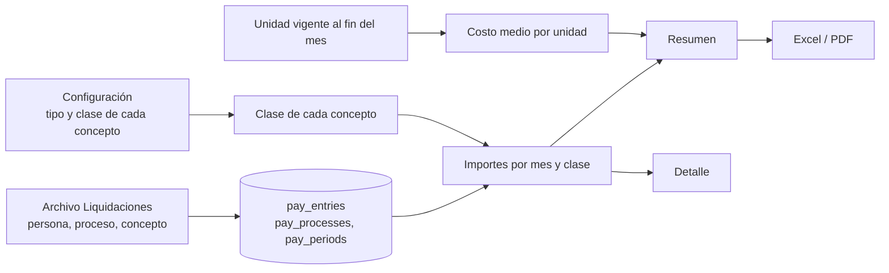

# Dashboard Payroll (Dashboard 5 de M3)

**Fecha:** 2026-10-21
**Estado:** MVP (resumen, detalle y exportaciones completos; pendiente el detalle por concepto, E4)

## Resumen

Muestra cuánto se paga y cómo se compone: la **masa salarial bruta**, el **costo medio por persona**, el **neto pagado** y el **costo de horas extra** con su peso sobre el sueldo; la evolución de 12 meses (bruto y neto), la composición por **clase de concepto** (haberes y retenciones) y el costo medio por cada **dimensión configurada del tenant**. Cada número se abre hasta los procesos, las clases, los conceptos y las unidades, y todo se exporta a Excel o PDF. Está pensado para una pantalla de 15.6" sin scroll.

Audiencia: RRHH, Compensaciones y finanzas (todos los roles del tenant ven el resumen; el listado de personas lo ve solo un admin, D-137). Datos: liquidaciones del archivo de Liquidaciones (`pay_*`), personas y unidades con vigencia. **wlA no recalcula nada**: usa los importes tal como vienen, con su signo (D-132).

## Arquitectura

### Tablas involucradas
- `pay_periods` (mes `AAAA-MM`) → `pay_processes` (mensual, SAC, ajustes...) → `pay_entries` (persona × concepto, importe y cantidad).
- `pay_concepts`: tipo (13 estándar), total de referencia (`gross` / `net`) y si está clasificado.
- `pay_concept_classes` y `pay_class_rules`: las clases del dashboard y qué tipo o concepto va a cada una (el concepto gana sobre el tipo).
- `hr_people_org_assignments`, `hr_org_units`, `dsh_dimensions` (dashboard `payroll`): unidades y dimensiones.
- `cfg_tenant_settings.currency`: moneda del tenant (una sola, D-135).

### Archivos clave
Todo bajo `apps/cliente/app/(dashboard)/payroll/`:

| Ruta | Contenido |
|---|---|
| `page.tsx` | Resumen (Server Component): tarjetas, gráficos, filtros y estados |
| `[scope]/[[...id]]/page.tsx` | Drill-down: `procesos`, `clase/<id o uncl>`, `dim/<tipo>/<id>`, `personas` (solo admin) |
| `export/route.ts` | Descarga Excel y PDF (`?format=xlsx|pdf` + filtros) |
| `_data/queries.ts` | `loadPayroll`, `loadConfig` (clase de cada concepto), `loadMonthly`, `resolveRange` y los armadores de SQL |
| `_data/detail-queries.ts` | Listados del drill-down |
| `_data/filters.ts`, `hrefs.ts`, `types.ts` | Parámetros de URL, enlaces y tipos (incluye `MIN_PERSONS = 3`) |
| `_components/` | Evolución, composición por clase, barras de costo por dimensión, filtros, frescura y formato de moneda |
| `_export/` | `report.ts`, `xlsx.ts`, `pdf-document.tsx` |

Del kit compartido (`_dashboard-kit/`) se reutilizan el shell, las tarjetas, el selector de período, los filtros por dimensión, el menú de exportación y las pestañas de dimensiones.

### Flujo de datos



## Reglas de cálculo

- **Mes de referencia:** el último período con liquidaciones (código `AAAA-MM`). Un mes sin liquidación figura como **sin datos**, no como cero (y el período anterior se compara solo si tiene datos).
- **Masa salarial bruta** = el concepto marcado como **total bruto** (acumulador) sumando todos los procesos del período (mensual, SAC, ajustes...). Si no hay total bruto marcado, es la **suma de las clases de haber** y la tarjeta lo avisa (D-132).
- **Neto pagado** = el concepto marcado como **total neto**. Sin él, la tarjeta muestra "—" y un aviso con enlace a Configuración.
- **Costo medio por persona** = masa bruta ÷ **personas-mes pagadas** (personas con importe en la masa bruta de cada mes): es el costo mensual promedio de quien cobró. En períodos de varios meses sigue siendo un valor mensual.
- **Costo de horas extra** = importe de la clase de código `horas_extra`; el % es sobre el importe de la clase `sueldo`. Los códigos no cambian aunque se renombre la clase.
- **Composición:** importes por clase tal como vienen; las retenciones se muestran en valor absoluto y aparte. Los % son sobre el total de **haberes de las clases**. Los conceptos **sin clasificar** figuran aparte; las contribuciones patronales, provisiones y acumuladores sin marcar no entran.
- **Clase de un concepto:** regla por concepto, si no la tiene, regla por tipo. Un concepto de una clase inactiva no entra.
- **Unidad de la persona:** la vigente al **fin del mes liquidado** (no la de hoy). Por eso el filtro y las barras por dimensión usan la unidad de cada mes.
- **Promedio 12m** (tarjetas de masa y costo medio): promedio de los últimos 12 meses con datos, llevado al largo del período; solo si hay al menos 6 meses y el período no es de 12 meses.
- **Privacidad (D-135):** solo agregados. Las celdas (unidad, mes o proceso) con **menos de 3 personas** no muestran importes: figuran como "reservado". Si los filtros dejan menos de 3 personas por mes, el resumen entero se reserva. El listado de **personas** (importe por persona) lo ve solo un **admin**.
- **Importes pagados, no devengados:** si el cliente paga horas extra o ausencias a mes vencido, los importes de un mes corresponden a horas del mes anterior. La pantalla lo aclara en "Cómo se calcula". Está registrado para resolverlo (Open-18).

## Pantallas y navegación

- **Resumen:** 4 tarjetas (cada una con variación contra el período anterior), evolución de 12 meses (bruto y neto), composición por clase (pestañas Haberes y Retenciones) y un panel de costo medio por cada dimensión (si hay más de 4 dimensiones, la última agrupa el resto en pestañas). Filtros: período (último mes, 12 meses, año) y unidades por dimensión; el estado vive en la URL.
- **Drill-down con breadcrumb:** tarjetas y barras llevan a `procesos` (con masa y neto por proceso), `clase/<id>` (conceptos de la clase) o `dim/<tipo>/<unidad>` (composición de una unidad). `personas` (ranking por masa bruta, con búsqueda y paginación) se abre desde la tarjeta de costo medio y solo lo ve un admin.
- **Exportación:** Excel (resumen, evolución, composición, por dimensión y procesos) y PDF. No incluyen importes por persona.
- **Estados:** sin liquidaciones, sin resultados con los filtros, restringido por privacidad, comparación no disponible, cobertura parcial, sin liquidaciones nuevas hace más de 75 días y conceptos sin clasificar o total bruto sin marcar (con enlace a la configuración).

## Rendimiento

Medido con 3.000 personas, 24 meses y 864 mil entradas (script `apps/cliente/scripts/bench-payroll.ts`): con estadísticas al día el resumen tarda **0,6 s (mes) y 1,8 a 1,9 s (año y 12 meses)**; los detalles, menos de 0,4 s. Decisiones que lo logran:
- **Se agrega solo lo necesario:** los importes por clase salen de una pasada sin pasar por persona; las personas y el costo por unidad se calculan solo sobre los conceptos de la masa bruta.
- **Plan independiente de las estadísticas:** los procesos del rango se pasan como constantes y cada proceso se recorre con una subconsulta `LATERAL` (índice por proceso). Con estadísticas viejas (recién cargado el archivo) la primera consulta pasó de minutos a unos segundos. El worker además ejecuta `ANALYZE pay_entries` al terminar la carga.
- **Filtro por unidad una sola vez por persona y proceso** (CTE `elig`), no por cada entrada.
- Índice `pay_entries (concept_id, process_id)`: lee solo las filas del total bruto o neto de cada proceso.

## Verificación

`apps/cliente/scripts/verify-payroll-engine.ts` compara el motor con una implementación independiente que parte de las entradas: dos procesos en el mismo mes, un mes sin liquidación, cambio de área, concepto sin clasificar, concepto que no entra, regla por concepto sobre tipo, unidades y filtros de menos de 3 personas, y con o sin totales de bruto y neto marcados (8 casos de período y filtro × 2 configuraciones, más los detalles de procesos, clase, unidad y personas).

```bash
cd apps/cliente
../../packages/db/node_modules/.bin/tsx --env-file=.env.local scripts/verify-payroll-engine.ts
```

## Pendientes
- [ ] **E4:** detalle por concepto (histórico de un concepto y sus tarjetas) y anexos, solo si el uso los pide.
- [ ] Desfasaje entre lo pagado y lo ocurrido (Open-18): configuración por tenant de los tipos que se pagan a mes vencido y aviso en los dashboards.
- [ ] Meta o referencia de costo por tenant, si el cliente la pide.
- [ ] Accesibilidad con lector de pantalla probada, tablet y móvil (igual que los otros dashboards).

## Changelog
| Fecha | Cambio |
|---|---|
| 2026-10-21 | Versión inicial: resumen, detalle (procesos, clase, unidad y personas) y exportaciones |
