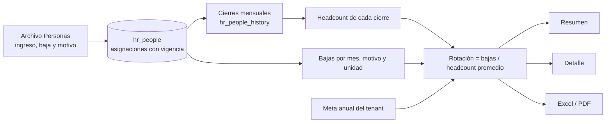

# Dashboard Rotación (Dashboard 4 de M3)

**Fecha:** 2026-10-21
**Estado:** MVP (resumen, detalle y exportaciones completos)

## Resumen

Muestra cuánta gente se va respecto de la meta y por qué: la **rotación** (bajas sobre el headcount promedio), la rotación voluntaria, las bajas por categoría y motivo, las bajas tempranas (menos de 1 año de antigüedad), la evolución de 12 meses (tasa mensual e ingresos contra egresos) y la rotación por cada **dimensión configurada del tenant**. Cada número se abre hasta las personas que se fueron, y todo se exporta a Excel o PDF. Está pensado para una pantalla de 15.6" sin scroll.

Audiencia: RRHH y People Analytics (todos los roles del tenant ven lo mismo). Datos: bajas (`hr_people`), cierres mensuales (`hr_people_history`) y unidades con vigencia. **No requiere tablas ni archivos nuevos**: todo sale del archivo de Personas.

## Arquitectura

### Tablas involucradas
- `hr_people`: fecha de ingreso, fecha de baja y motivo (`termination_reason_code`). Cada baja cuenta en la unidad vigente en la fecha de la baja.
- `hr_people_history`: cierre mensual por persona (estado a fin de mes: quien tiene baja ese mes ya no figura). El headcount sale de acá. Es un caché derivado (ver `carga-de-archivos.md`).
- `cfg_termination_reasons`: motivo y categoría (`voluntary`, `involuntary`, `end_of_contract`, `retirement`, `other`).
- `hr_people_org_assignments`, `hr_org_units`, `dsh_dimensions` (dashboard `turnover`): unidades y dimensiones del dashboard.
- `cfg_tenant_metric_targets` (`turnover_rate`): meta del tenant, **18 % anual** por defecto, editable en Configuración > Metas.

### Archivos clave
Todo bajo `apps/cliente/app/(dashboard)/turnover/`:

| Ruta | Contenido |
|---|---|
| `page.tsx` | Resumen (Server Component): KPIs, gráficos, filtros y estados |
| `[scope]/[[...id]]/page.tsx` | Drill-down: `bajas`, `tempranas`, `categoria/<código>`, `motivo/<código>`, `dim/<tipo>/<id>` |
| `export/route.ts` | Descarga Excel y PDF (`?format=xlsx|pdf` + filtros) |
| `_data/queries.ts` | `loadTurnover` y `resolveRange` |
| `_data/detail-queries.ts` | Listados del drill-down |
| `_data/filters.ts`, `hrefs.ts`, `types.ts` | Parámetros de URL, enlaces y tipos |
| `_components/` | Evolución con pestañas, panel de motivos, barras por dimensión, filtros y frescura |
| `_export/` | `report.ts`, `xlsx.ts`, `pdf-document.tsx` |

Del kit compartido (`_dashboard-kit/`) se reutilizan el shell, las tarjetas, los filtros, el menú de exportación, los gráficos de tasa (`rate-trend-chart`, `rate-bars-chart`) y `target-status`. Con este dashboard pasaron al kit **`snapshot-filters.ts`** (`snapFilter`, `eventFilter`, `SNAP_ARR`: filtros por unidad sobre cierres y eventos, antes dentro de Headcount, que los importa desde ahí) y la opción `curve` de la evolución.

### Flujo de datos



## Reglas de cálculo

- **Cierres:** `snapshot_date` es el primer día del mes y representa el estado al **cierre** del mes: figuran las personas con ingreso hasta fin de mes y sin baja hasta esa fecha. Una baja del 31 no figura en el cierre de su mes.
- **Mes de referencia:** el último cierre disponible (igual que Headcount).
- **Rotación del período** = bajas del período ÷ headcount promedio. El headcount promedio es el promedio de los cierres desde el **cierre de apertura** (el del mes anterior al inicio del período) hasta el de referencia. En períodos de varios meses se suman las bajas. Si faltan cierres intermedios se promedian los disponibles.
- **Primer cierre sin apertura:** el primer cierre no tiene el mes anterior, así que su mes figura como "sin datos" y el período se calcula desde el mes siguiente ("cobertura parcial"). La comparación se oculta si el período anterior no tiene apertura.
- **Meta prorrateada:** la meta del tenant es anual. Mes: 18 % ÷ 12 = 1,5 %; 12 meses: 18 %; año en curso: 18 % × meses ÷ 12. La pantalla muestra cuál meta usa.
- **Todas las bajas** (voluntaria, involuntaria, fin de contrato, jubilación y otra) entran en la tasa total (D-128). **Rotación voluntaria** = bajas de categoría voluntaria ÷ el mismo promedio. Los filtros por categoría y motivo afectan solo a las bajas (el headcount no cambia). La tasa no cuenta los ingresos (D-129).
- **Bajas tempranas:** menos de 12 meses cumplidos entre ingreso y baja (justo 12 no es temprana). **Antigüedad promedio al salir:** meses cumplidos promedio de las bajas del período.
- **Por dimensión:** bajas de la unidad en la fecha de la baja ÷ headcount promedio de la unidad en los cierres. Una unidad con headcount promedio menor a 3 lleva asterisco (muestra chica).
- **Referencia "Prom. 12m":** tasa de los últimos 12 meses (con al menos 6 meses con apertura) llevada al largo del período, para que sea comparable.
- **Alertas:** "N de M unidades por <primera dimensión> sobre la meta" (sin contar "Sin asignar").
- **Sin asignar:** cualquier dimensión admite el token `none`.
- **Limitaciones:** el historial llega hasta donde llegan los cierres (24 meses); los cierres son reconstruidos desde las asignaciones con vigencia, no congelados.

## Contrato de URL

| Parámetro | Significado |
|---|---|
| `p` | `month` (por defecto) \| `12m` \| `year` |
| `f_<tipo>` | Unidades de la dimensión, ids separados por coma; `none` = Sin asignar |
| `f_cat` | Categorías de baja (`voluntary`, `involuntary`, `end_of_contract`, `retirement`, `other`) |
| `f_reason` | Códigos de motivo de baja |
| `q`, `s`, `d`, `page` | Solo en el detalle: búsqueda, orden (`term` por defecto, `name`, `code`, `tenure`) y página (50 por página) |

## Pantalla y estados

- **Distribución:** 4 tarjetas (rotación contra la meta, rotación voluntaria, bajas con su desglose por categoría, bajas tempranas con el % y la antigüedad promedio al salir); fila 1 = evolución de 12 meses (pestañas "Tasa mensual" e "Ingresos y egresos") + bajas por categoría o motivo; fila 2 = una rotación por dimensión (más de 4: el último panel pasa a pestañas); pie con el headcount promedio, la meta y "Cómo se calcula".
- **Estados:** carga, vacío (sin cierres, o "falta historia" con un solo cierre), sin resultados, desactualizado (más de 45 días desde el cierre), cobertura parcial y comparación no disponible.
- **Accesibilidad:** resumen textual y tabla equivalente por gráfico, estado de la meta con ícono y texto, filtros y pestañas operables con teclado.

## Detalle y exportaciones

- **Detalle:** páginas con breadcrumb, búsqueda por nombre o legajo, orden y paginación. Una fila por baja: nombre, legajo, una columna por dimensión (unidad vigente en la fecha de la baja), fecha de baja, motivo, categoría y antigüedad. Orden por fecha de baja descendente (D-130). Las bajas ya se listan con nombre y motivo en Headcount, así que no cambia la sensibilidad.
- **Excel:** hojas Resumen (metadatos, filtros, KPIs y notas), Evolución (tasa, meta mensual, ingresos y egresos), Bajas por motivo, Por dimensión y Bajas.
- **PDF paginado** con cabecera de filtros, indicadores, distribuciones y el listado de bajas con cabecera repetida.
- **Tope:** 20.000 filas.

## Decisiones técnicas relevantes

- **Filtros por unidad en el kit:** los comparten Headcount y Rotación; antes de moverlos se capturaron 60 resultados de Headcount (resumen y detalle, 15 combinaciones) y después se verificó que no hubiera ninguna diferencia.
- **Cálculo en SQL simple, sin motor de piezas:** no hay horas programadas, alcanzan los cierres mensuales y las fechas de baja.
- **Meta prorrateada, no anualizada:** comparar el mes contra el 18 % anual daría siempre "dentro de la meta"; se compara contra 1,5 % por mes.

## Cómo extender

- **Nueva dimensión:** configuración en el CMP (`dsh_dimensions`, dashboard `turnover`); sin código.
- **Nuevo KPI:** agregarlo al cálculo de `loadTurnover`, a `types.ts`, a la tarjeta en `page.tsx` y a `kpiRows` en `_export/report.ts`.
- **Verificación de regresión:** `apps/cliente/scripts/verify-turnover-engine.ts` crea un tenant temporal con casos de borde, genera sus cierres mensuales, compara resumen y detalle contra una implementación independiente que parte de las fechas de ingreso y baja (no de los cierres) y lo borra. Correrlo tras cualquier cambio del cálculo:
  ```bash
  cd apps/cliente && ../../packages/db/node_modules/.bin/tsx --env-file=.env.local scripts/verify-turnover-engine.ts
  ```

## Ajustes y aprendizajes

- **Verificar contra otra fuente:** la verificación independiente parte de las fechas, no de los cierres, así que también detecta diferencias entre el dashboard y la forma de armar los cierres (por ejemplo, la baja del último día del mes).
- **Una línea curva exagera los meses en cero:** la evolución de la rotación usa línea recta (`curve="linear"`); el resto de los dashboards mantiene la curva.
- **Meta anual contra períodos cortos:** hay que prorratear; la tarjeta aclara la meta del período y la meta anual.

## Pendientes
- [ ] Rotación sobre un headcount de apertura calculado desde las fechas (hoy el primer cierre no tiene apertura).
- [ ] Rotación por antigüedad y por motivo cruzados (por ejemplo, voluntaria por tramo de antigüedad).
- [ ] Accesibilidad verificada con lector de pantalla y teclado en el navegador real; comportamiento en tablet y móvil.

## Changelog
| Fecha | Cambio |
|---|---|
| 2026-10-21 | Versión inicial: cálculo, resumen, detalle y exportaciones |
